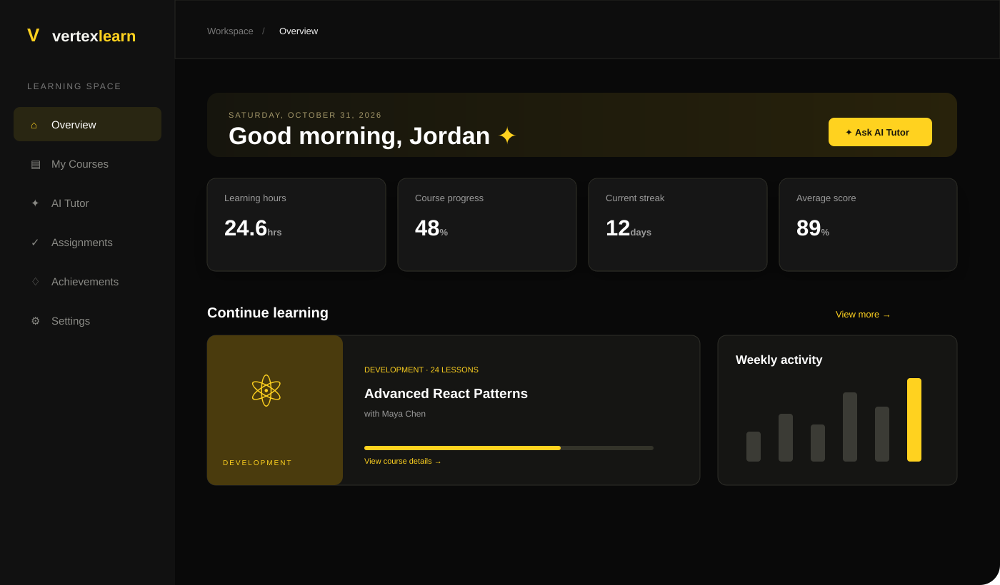

# Vertex Learn



**Vertex Learn** is a polished, responsive learning workspace for students. It combines course discovery, progress tracking, an AI Tutor demo, study planning, notes, achievements, and a focused black-and-yellow interface.

> **Demo status:** This repository contains a production-quality frontend demonstration. Data is intentionally stored in the browser with `localStorage`; no real credentials, payment data, or private user information should be used.

## Features

- Demo sign-in and sign-out flow
- Responsive dashboard for desktop, tablet, and mobile
- Black-and-yellow visual system with live ambient background
- Four-course overview with search and expanded course catalog
- Detailed course modal with instructor, duration, level, lessons, rating, and topics
- Persistent course enrollment
- AI Tutor demo with contextual replies and saved conversation history
- Weekly activity chart with simulated live updates
- Course progress and live learning metrics
- Assignments with completion state and browser persistence
- Study notes modal with saved notes
- Focus timer with start, pause, reset, and completion feedback
- Learning roadmap with completed, active, and locked milestones
- Weekly goal and learner leaderboard cards
- Notification drawer and toast feedback
- Editable profile with persisted name, email, bio, and learning goal
- Escape-key support for overlays and accessible controls
- Reduced-motion support for users who prefer less animation

## Demo account

| Field | Value |
|---|---|
| Email | `demo@vertexlearn.com` |
| Password | `demo123` |

## Tech stack

- React 19
- TypeScript
- Vite
- CSS with responsive media queries
- Local browser storage for demo persistence
- Oxlint

## Getting started

### Requirements

- Node.js 20 or newer
- npm 10 or newer

### Install and run

```bash
npm install
npm run dev
```

Open the local URL printed by Vite, usually `http://127.0.0.1:5173`.

### Production build

```bash
npm run lint
npm run build
npm run preview
```

## Project structure

```text
src/
  App.tsx            Main application workflows and demo state
  App.css            Base dashboard styling
  enhancements.css   Theme, responsive layout, motion, and components
  index.css          Global typography and reset
docs/
  vertex-learn-preview.svg
public/
  favicon.svg
```

## Data behavior

The demo stores profile data, notes, tutor messages, assignment completion, and enrollments in browser `localStorage`. Live metrics and chart values are simulated in the browser to demonstrate how a connected dashboard could behave.

For production, replace these client-side stores with:

1. A Node.js/Express API.
2. PostgreSQL for users, courses, progress, assignments, and notes.
3. Secure password authentication and role-based authorization.
4. An LLM service with retrieval-augmented generation over course materials.
5. Object storage for documents and assignment uploads.

## Validation

The project has been checked with:

```bash
npm run lint
npm run build
```

Browser smoke tests cover login, navigation, search, course details, enrollment, AI Tutor, notifications, profile editing, notes, timer controls, persistence, and mobile navigation.

## Repository

[github.com/omsatote/vertex-learn-lms-ai](https://github.com/omsatote/vertex-learn-lms-ai)

## License

This demonstration is provided for evaluation and further development.
